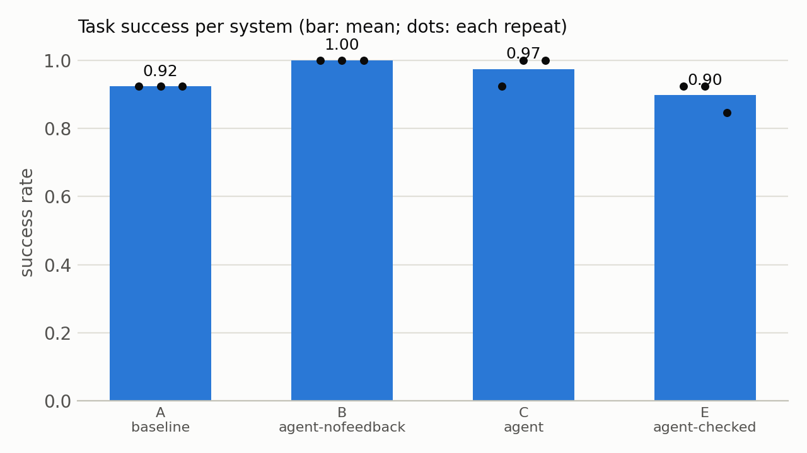
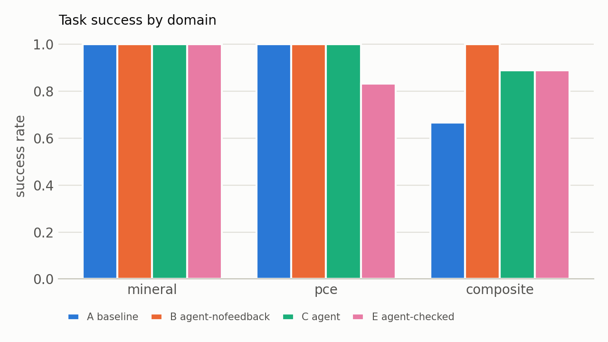

# Results: A, B, C, E on 13 tasks × 3 repeats

Generated by `python -m eval.experiment tables` on 2026-11-03 from `runs/exp/dev_20261103-180733`. git 63f10a8 · validator 1.0.0 · split 063c2ddad24b… · Large-scale Atomic/Molecular Massively Parallel Simulator - 22 Jul 2025 - Update 6. Success = every Tier 0–3 check PASS and TC.2 PASS (METRICS.md v1.1); rates are means of per-task rates.

Model: claude-sonnet-5-5. Prices: https://platform.claude.com/docs/en/about-claude/pricing (and models/overview), fetched 2026-10-27, re-checked unchanged 2026-11-03 (2026-11-03).

## 1. Success per system

| | System | Success | Spread across repeats (mean ± sd, min–max) | pass@3 | Validity |
|---|---|---|---|---|---|
| **A** | baseline (single call, no tools) | **0.923** | 0.923 ± 0.000 (0.923–0.923) | 0.923 | 0.923 |
| **B** | agent-nofeedback (loop, retries without feedback) | **1.000** | 1.000 ± 0.000 (1.000–1.000) | 1.000 | 1.000 |
| **C** | agent (loop + validator feedback) | **0.974** | 0.974 ± 0.044 (0.923–1.000) | 1.000 | 1.000 |
| **E** | agent-checked (C + build summary + request check) | **0.897** | 0.897 ± 0.044 (0.846–0.923) | 0.923 | 1.000 |

## 2. Success by domain, difficulty and force field

| Domain | composite (3 tasks) | mineral (4 tasks) | pce (6 tasks) |
|---|---|---|---|
| A | 0.667 | 1.000 | 1.000 |
| B | 1.000 | 1.000 | 1.000 |
| C | 0.889 | 1.000 | 1.000 |
| E | 0.889 | 1.000 | 0.833 |

| Difficulty | easy (3 tasks) | hard (4 tasks) | representative (6 tasks) |
|---|---|---|---|
| A | 1.000 | 0.750 | 1.000 |
| B | 1.000 | 1.000 | 1.000 |
| C | 1.000 | 1.000 | 0.944 |
| E | 1.000 | 1.000 | 0.778 |

| Force field | cvff (6 tasks) | pcff (7 tasks) |
|---|---|---|
| A | 0.833 | 1.000 |
| B | 1.000 | 1.000 |
| C | 0.944 | 1.000 |
| E | 0.944 | 0.857 |

## 3. Ablation contrasts (same tasks, same repeats)

| Contrast | What it isolates | Δ success | Tasks better / same / worse | Sign test p |
|---|---|---|---|---|
| B vs A | tools and retries | +0.077 | 1 / 12 / 0 | 1.000 |
| C vs B | validator feedback | -0.026 | 0 / 12 / 1 | 1.000 |
| C vs A | the whole agent | +0.051 | 1 / 11 / 1 | 1.000 |
| E vs C | request check | -0.077 | 0 / 12 / 1 | 1.000 |

Per-task rates over 13 tasks; ties are dropped by the sign test, which reaches p < 0.05 only with at least 6 tasks better and none worse. Report the per-task counts, not only the mean.

## 4. Failure categories (runs)

| | NO_OUTPUT | TC_ONLY |
|---|---|---|
| A | 3 | 0 |
| B | 0 | 0 |
| C | 0 | 1 |
| E | 0 | 4 |

## 5. Baseline (A) failures: how often each system succeeded on the same task and repeat

| A's failure | Runs | B | C | E |
|---|---|---|---|---|
| NO_OUTPUT | 3 | 3/3 | 3/3 | 3/3 |

## 6. Inside the loop: first attempt -> final success

The first attempt's outcome as the loop saw it (in-loop validation, request check for E); "accepted in attempt 1" runs can still fail TC.2 afterwards.

**B** (agent-nofeedback): accepted in attempt 1 → 39/39 succeed

**C** (agent): accepted in attempt 1 → 38/39 succeed

**E** (agent-checked): accepted in attempt 1 → 33/33 succeed; REQ:supercell → 2/3 succeed; REQ:backbone_units_per_chain → 0/3 succeed

## 7. Attempts, tokens, cost, latency (per task run)

| | Mean attempts | Escalations | Input tokens | Output tokens | Cache read | Cost (USD) | Total (USD) | Latency mean / max (s) |
|---|---|---|---|---|---|---|---|---|
| A | 1.0 | 0 | 152 | 311 | 5249 | 0.00428 | 0.167 | 5.69 / 14.58 |
| B | 1.0 | 0 | 6 | 743 | 13756 | 0.01071 | 0.4177 | 12.46 / 28.6 |
| C | 1.0 | 0 | 6 | 734 | 14309 | 0.00973 | 0.3796 | 12.29 / 29.48 |
| E | 1.154 | 0 | 1970 | 1010 | 17224 | 0.01791 | 0.6984 | 17.77 / 58.08 |

The validator's own results (948 corrupted files, 0 missed) are in docs/VALIDATOR_RESULTS.md.

## Figures

