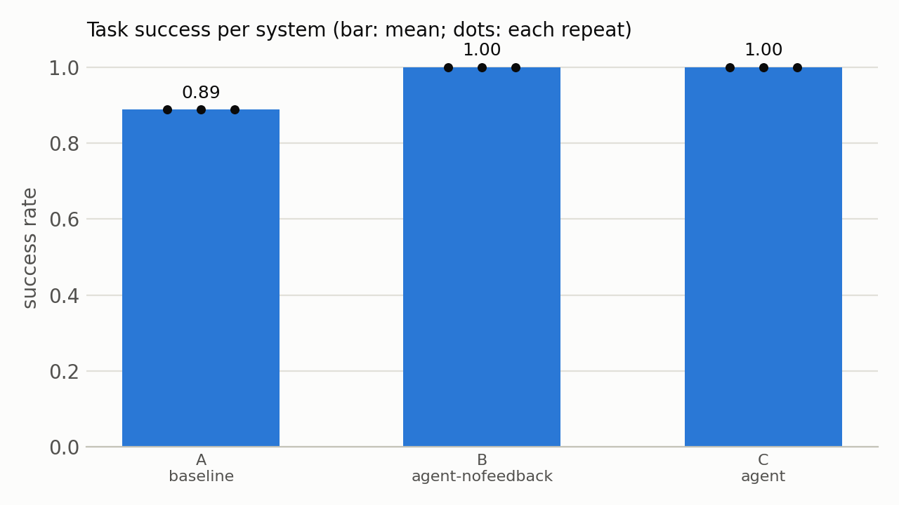
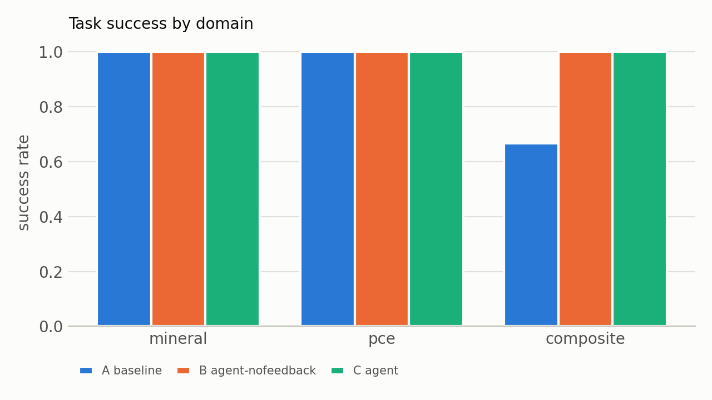

# Results: A, B, C on 9 tasks × 3 repeats

Generated by `python -m eval.experiment tables` on 2026-11-06 from `runs/exp/test_20261106-021208`. git 64ac239 · validator 1.0.0 · split 063c2ddad24b… · Large-scale Atomic/Molecular Massively Parallel Simulator - 22 Jul 2025 - Update 6. Success = every Tier 0–3 check PASS and TC.2 PASS (METRICS.md v1.2); rates are means of per-task rates.

Model: claude-sonnet-5-5. Prices: https://platform.claude.com/docs/en/about-claude/pricing (and models/overview), fetched 2026-10-27, re-checked unchanged 2026-11-03 (2026-11-03).

## 1. Success per system

| | System | Success | Spread across repeats (mean ± sd, min–max) | pass@3 | Validity |
|---|---|---|---|---|---|
| **A** | baseline (single call, no tools) | **0.889** | 0.889 ± 0.000 (0.889–0.889) | 0.889 | 0.889 |
| **B** | agent-nofeedback (loop, retries without feedback) | **1.000** | 1.000 ± 0.000 (1.000–1.000) | 1.000 | 1.000 |
| **C** | agent (loop + validator feedback) | **1.000** | 1.000 ± 0.000 (1.000–1.000) | 1.000 | 1.000 |

## 2. Success by domain, difficulty and force field

| Domain | composite (3 tasks) | mineral (3 tasks) | pce (3 tasks) |
|---|---|---|---|
| A | 0.667 | 1.000 | 1.000 |
| B | 1.000 | 1.000 | 1.000 |
| C | 1.000 | 1.000 | 1.000 |

| Difficulty | easy (3 tasks) | hard (3 tasks) | representative (3 tasks) |
|---|---|---|---|
| A | 1.000 | 1.000 | 0.667 |
| B | 1.000 | 1.000 | 1.000 |
| C | 1.000 | 1.000 | 1.000 |

| Force field | cvff (2 tasks) | pcff (7 tasks) |
|---|---|---|
| A | 1.000 | 0.857 |
| B | 1.000 | 1.000 |
| C | 1.000 | 1.000 |

## 3. Ablation contrasts (same tasks, same repeats)

| Contrast | What it isolates | Δ success | Tasks better / same / worse | Sign test p |
|---|---|---|---|---|
| B vs A | tools and retries | +0.111 | 1 / 8 / 0 | 1.000 |
| C vs B | validator feedback | +0.000 | 0 / 9 / 0 | 1.000 |
| C vs A | the whole agent | +0.111 | 1 / 8 / 0 | 1.000 |

Per-task rates over 9 tasks; ties are dropped by the sign test, which reaches p < 0.05 only with at least 6 tasks better and none worse. Report the per-task counts, not only the mean.

## 4. Failure categories (runs)

| | NO_OUTPUT |
|---|---|
| A | 3 |
| B | 0 |
| C | 0 |

## 5. Baseline (A) failures: how often each system succeeded on the same task and repeat

| A's failure | Runs | B | C |
|---|---|---|---|
| NO_OUTPUT | 3 | 3/3 | 3/3 |

## 6. Inside the loop: first attempt -> final success

The first attempt's outcome as the loop saw it (in-loop validation, request check for E); "accepted in attempt 1" runs can still fail TC.2 afterwards.

**B** (agent-nofeedback): accepted in attempt 1 → 27/27 succeed

**C** (agent): accepted in attempt 1 → 27/27 succeed

## 7. Attempts, tokens, cost, latency (per task run)

| | Mean attempts | Escalations | Input tokens | Output tokens | Cache read | Cost (USD) | Total (USD) | Latency mean / max (s) |
|---|---|---|---|---|---|---|---|---|
| A | 1.0 | 0 | 145 | 325 | 5257 | 0.00457 | 0.1235 | 6.75 / 28.57 |
| B | 1.0 | 0 | 6 | 676 | 13714 | 0.01001 | 0.2703 | 18.22 / 60.75 |
| C | 1.0 | 0 | 6 | 672 | 14115 | 0.00903 | 0.2439 | 18.57 / 63.5 |

The validator's own results (948 corrupted files, 0 missed) are in docs/VALIDATOR_RESULTS.md.

## Figures

